# 宿舍维修管理系统的设计与实现

> 🎓 **计算机毕业设计 · 宿舍维修管理系统的设计与实现**
>
> 本仓库只放**项目介绍 + 运行截图**（截图是站点带水印的原图，存在仓库 `images/` 里）。
>
> 👉 **完整可运行源码 / 数据库脚本 / 部署文档：[点我获取](https://geekcode.top/archives/%E5%AE%BF%E8%88%8D%E7%BB%B4%E4%BF%AE%E7%AE%A1%E7%90%86%E7%B3%BB%E7%BB%9F%E7%9A%84%E8%AE%BE%E8%AE%A1%E4%B8%8E%E5%AE%9E%E7%8E%B0?utm_source=github)**
>
> 💬 咨询微信：**ir9372**　|　🌐 更多项目：[极客代码 geekcode.top](https://geekcode.top/?utm_source=github)
>
> 📌 项目详情页：<https://geekcode.top/archives/%E5%AE%BF%E8%88%8D%E7%BB%B4%E4%BF%AE%E7%AE%A1%E7%90%86%E7%B3%BB%E7%BB%9F%E7%9A%84%E8%AE%BE%E8%AE%A1%E4%B8%8E%E5%AE%9E%E7%8E%B0?utm_source=github>

<table><td width="230" align="center"> <b>扫码加微信 ir9372</b></td><td valign="middle">📦 源码 = 项目介绍 + 全部运行截图 + 数据库 + 部署文档 👉 点上方任意截图，直接跳到 <b>极客代码 geekcode.top</b> 详情页</td></table>

---

<h1>宿舍维修管理系统的设计与实现</h1>
<h2>项目概述</h2>

本项目旨在构建一个高效、便捷的宿舍维修管理平台，解决高校宿舍设施报修流程繁琐、进度不透明及维修资源分配不均等痛点。系统采用前后端分离架构，核心功能涵盖学生在线报修、维修订单全流程跟踪、知识信息分享及公告发布。适用人群主要为在校学生、宿舍管理员及专业维修人员。技术架构基于 Spring Boot 后端框架与 Vue 前端框架，结合 MyBatis-Plus 进行数据持久化操作，并引入 Shiro 实现安全权限控制，确保系统在多角色并发访问下的稳定性与安全性。

<h2>技术架构</h2>
<h3>总体架构设计</h3>

系统采用经典的前后端分离模式。前端使用 Vue.js 构建用户界面，通过 HTTP 请求与后端交互；后端基于 Spring Boot 框架提供 RESTful API 服务，负责业务逻辑处理、数据校验及权限管理。数据库选用 MySQL 存储结构化数据，利用 MyBatis-Plus 简化 SQL 编写与对象映射，提升开发效率。

<h3>核心技术选型理由</h3>
<ol>
<li><strong>Spring Boot</strong>：作为后端核心框架，其“约定优于配置”的特性极大地简化了应用搭建过程，内置的 Tomcat 容器便于独立部署，且拥有庞大的社区支持生态。</li>
<li><strong>MyBatis-Plus</strong>：在 MyBatis 基础上增强，提供了通用的 CRUD 接口和条件构造器，减少了大量重复代码，同时保持了对复杂 SQL 查询的支持能力。</li>
<li><strong>Shiro</strong>：轻量级的安全框架，用于处理身份认证（Authentication）和授权（Authorization）。相比 Spring Security，Shiro 更易于集成和理解，适合中小型管理系统的安全需求。</li>
<li><strong>Vue.js</strong>：渐进式 JavaScript 框架，组件化开发模式使得前台页面（如首页、个人中心、列表页）的复用性高，响应速度快，用户体验良好。</li>
</ol>
<h3>数据库设计要点</h3>

数据库设计遵循第三范式，主要实体包括用户（学生、维修员、管理员）、宿舍信息、楼栋信息、报修单、维修订单、评价信息及知识文章等。各表之间通过外键关联，例如“报修信息”关联“学生ID”和“宿舍ID”，“维修订单”关联“报修ID”和“维修员ID”，确保数据的一致性与完整性。

<h2>功能模块</h2>

根据源码 Controller 列表及截图功能，系统分为前台用户端和后台管理端两大模块。

<h3>前台用户端功能</h3>

前台主要面向学生和普通访客，提供信息浏览与自助服务功能。

<ol>
<li><strong>首页展示</strong>：聚合展示最新公告、热门知识信息及轮播图内容。</li>
<li><strong>知识信息服务</strong>：</li>
</ol>
<ul>
<li><strong>知识分类/信息浏览</strong>：查看宿舍维护相关的指南、技巧文章。</li>
<li><strong>评论互动</strong>：用户对知识信息进行评论交流（对应 <code>DiscusszhishixinxiController</code>）。</li>
</ul>
<ol start="3">
<li><strong>公告信息</strong>：查看学校或宿舍管理处发布的正式通知。</li>
<li><strong>留言板</strong>：用户提交反馈或建议，查看留言列表（对应 <code>MessagesController</code>）。</li>
<li><strong>个人中心</strong>：</li>
</ol>
<ul>
<li><strong>我的报修</strong>：提交新的报修申请，查看历史报修记录（对应 <code>BaoxiuxinxiController</code>）。</li>
<li><strong>维修进度跟踪</strong>：实时查看当前维修工单的状态（对应 <code>Weixiujindu</code> 相关逻辑）。</li>
<li><strong>评价管理</strong>：对已完成的维修服务进行评分和文字评价（对应 <code>PingjiaxinxiController</code>）。</li>
<li><strong>收藏列表</strong>：收藏感兴趣的知识信息或公告（对应 <code>StoreupController</code>）。</li>
</ul>
<ol start="6">
<li><strong>关于我们</strong>：查看平台介绍及联系方式（对应 <code>AboutusController</code>）。</li>
</ol>
<h3>后台管理端功能</h3>

后台主要面向管理员，具备完整的 CRUD（增删改查）权限，用于维护系统数据和业务流程。

<ol>
<li><strong>基础信息管理</strong>：</li>
</ol>
<ul>
<li><strong>用户管理</strong>：对学生账号、维修员账号进行管理（对应 <code>/xuesheng</code>, <code>/weixiuyuan</code> 路由及控制器）。</li>
<li><strong>宿舍与楼栋管理</strong>：录入和维护宿舍基本信息、楼栋分布情况（对应 <code>/sushexinxi</code>, <code>/loudongxinxi</code>）。</li>
<li><strong>宿舍分配</strong>：处理学生与宿舍的绑定关系（对应 <code>SushefenpeiController</code>）。</li>
</ul>
<ol start="2">
<li><strong>维修业务流程管理</strong>：</li>
</ol>
<ul>
<li><strong>报修审核</strong>：查看学生提交的报修详情，指派维修任务。</li>
<li><strong>维修订单管理</strong>：生成和管理具体的维修工单，更新状态（对应 <code>/weixiudingdan</code>）。</li>
<li><strong>维修进度监控</strong>：全局查看所有维修任务的执行阶段。</li>
<li><strong>评价审核</strong>：查看并管理学生对维修服务的反馈。</li>
</ul>
<ol start="3">
<li><strong>内容与资讯管理</strong>：</li>
</ol>
<ul>
<li><strong>公告管理</strong>：发布、编辑、删除系统公告（对应 <code>/news</code>）。</li>
<li><strong>知识库管理</strong>：维护知识分类和内容文章（对应 <code>/zhishifenlei</code>, <code>/zhishixinxi</code>）。</li>
<li><strong>评论管理</strong>：审核用户在前台发表的知识评论（对应 <code>/discusszhishixinxi</code>）。</li>
<li><strong>留言板管理</strong>：回复或删除用户留言（对应 <code>/messages</code>）。</li>
</ul>
<ol start="4">
<li><strong>系统设置</strong>：</li>
</ol>
<ul>
<li><strong>轮播图管理</strong>：配置首页展示的图片和链接。</li>
<li><strong>系统简介/关于我们</strong>：编辑前台显示的静态文本内容（对应 <code>/systemintro</code>, <code>/aboutus</code>）。</li>
<li><strong>参数配置</strong>：管理系统的全局配置项（对应 <code>ConfigController</code>）。</li>
</ul>
<h2>用户角色与权限</h2>

系统基于 Shiro 框架实现权限控制，主要涉及以下三类角色：

<table>
<thead>
<tr>
<th align="left">角色</th>
<th align="left">描述</th>
<th align="left">可访问功能模块</th>
</tr>
</thead>
<tbody><tr>
<td align="left"><strong>普通用户 (学生)</strong></td>
<td align="left">系统的最终使用者，发起维修需求并获取服务。</td>
<td align="left"><strong>前台所有功能</strong>：1. 浏览首页、公告、知识信息、关于我们。2. 提交报修申请、查看个人报修记录与维修进度。3. 对维修服务进行评价。4. 收藏知识信息、参与知识评论、发布留言。5. 管理个人信息。</td>
</tr>
<tr>
<td align="left"><strong>维修员</strong></td>
<td align="left">负责具体维修任务执行的专业人员。</td>
<td align="left"><strong>部分后台/特定视图功能</strong>：1. 查看指派给自己的维修订单。2. 更新维修进度状态（如：已接单、维修中、已完成）。3. 根据系统设计，可能仅能通过特定入口查看待办事项，具体取决于后端接口鉴权策略（注：源码显示有 WeixiuyuanController，暗示其有独立的管理视角或数据可见性）。</td>
</tr>
<tr>
<td align="left"><strong>管理员</strong></td>
<td align="left">系统最高权限拥有者，负责整体运营与维护。</td>
<td align="left"><strong>后台全部功能</strong>：1. <strong>用户管理</strong>：增删改查学生、维修员账号。2. <strong>资源管理</strong>：维护宿舍信息、楼栋信息、宿舍分配关系。3. <strong>业务管理</strong>：审核报修、创建/分配维修订单、监控维修进度、查看评价。4. <strong>内容管理</strong>：发布公告、维护知识库、管理评论与留言。5. <strong>系统配置</strong>：管理轮播图、系统简介、全局参数配置。</td>
</tr>
</tbody></table>

<em>注：根据提供的 Controller 列表，<code>CommonController</code> 通常处理文件上传下载等通用逻辑，<code>FileController</code> 专门处理文件流，这些属于基础设施支撑，不直接对应特定角色的业务菜单。</em>

<h2>项目特色与创新点</h2>
<ol>
<li><strong>闭环维修流程管理</strong>：实现了从“学生报修 -&gt; 管理员派单 -&gt; 维修员执行 -&gt; 进度更新 -&gt; 学生评价”的完整业务闭环。通过 <code>Weixiujindu</code>（维修进度）和 <code>Pingjiaxinxi</code>（评价信息）模块，确保了服务质量的可追溯性和透明度。</li>
<li><strong>知识赋能与服务延伸</strong>：不仅限于故障修复，还引入了“知识信息”模块 (<code>Zhishixinxi</code>)，提供宿舍维护常识、预防指南等内容，并通过评论功能 (<code>Discusszhishixinxi</code>) 促进用户间的经验交流，体现了“预防为主，维修为辅”的服务理念。</li>
<li><strong>多维度的数据统计与管理</strong>：后台集成了宿舍分配 (<code>Sushefenpei</code>)、楼栋 (<code>Loudongxinxi</code>) 和维修员 (<code>Weixiuyuan</code>) 的管理，为管理人员提供了清晰的资源视图，有助于优化维修人员的调度效率和宿舍资源的合理分配。</li>
<li><strong>安全性与规范性</strong>：引入 Apache Shiro 进行细粒度的权限控制，防止越权操作；使用 MyBatis-Plus 统一数据访问层规范，提高了代码的可维护性和执行效率。</li>
</ol>
<h2>部署环境</h2>

为确保系统正常运行，需准备以下软硬件环境：

<h3>软件环境</h3>
<ol>
<li><strong>操作系统</strong>：Windows 10/11, macOS, 或 Linux (CentOS/Ubuntu)。</li>
<li><strong>JDK</strong>：Java Development Kit 1.8 或以上版本（推荐 JDK 8，以兼容 Spring Boot 旧版本依赖）。</li>
<li><strong>数据库</strong>：MySQL 5.7 或 MySQL 8.0。需初始化数据库脚本以创建表结构。</li>
<li><strong>构建工具</strong>：Maven 3.6+（用于后端依赖管理和打包）。</li>
<li><strong>Node.js</strong>：v12.x 或 v14.x LTS 版本（用于前端 Vue 项目的依赖安装和编译）。</li>
<li><strong>包管理器</strong>：npm 或 yarn（随 Node.js 安装）。</li>
</ol>
<h3>硬件建议</h3>
<ol>
<li><strong>CPU</strong>：双核及以上处理器。</li>
<li><strong>内存</strong>：至少 4GB RAM（推荐 8GB，以便同时运行后端服务、前端开发服务器及数据库）。</li>
<li><strong>硬盘</strong>：至少 10GB 可用空间。</li>
</ol>
<h3>启动步骤简述</h3>
<ol>
<li><strong>数据库配置</strong>：安装 MySQL，创建数据库，导入项目提供的 <code>.sql</code> 文件。修改后端 <code>application.yml</code> 中的数据库连接 URL、用户名和密码。</li>
<li><strong>后端启动</strong>：在项目根目录执行 Maven 命令 <code>mvn clean install</code>，然后运行主类或使用 <code>java -jar</code> 启动 Spring Boot 应用。默认端口通常为 8080。</li>
<li><strong>前端启动</strong>：进入前端目录（vue-integrated 项目中的 frontend 文件夹），执行 <code>npm install</code> 安装依赖，随后执行 <code>npm run serve</code> (开发模式) 或 <code>npm run build</code> (生产模式)。</li>
<li><strong>访问系统</strong>：浏览器访问前端启动的地址（如 <code>http://localhost:8080</code> 或配置的其他端口），即可进入登录页面。</li>
</ol>
<h2>五、技术特性</h2>
<ul>
<li>前后端集成部署，前端资源打包至后端 static 目录</li>
<li>使用 MyBatis-Plus 简化数据访问层开发</li>
<li>集成 Shiro 权限框架实现角色权限控制</li>
</ul>
<h2>六、功能模块截图</h2>
<h3>前台用户端</h3>
<h4>前台-报修信息列表</h4>

<a href="https://geekcode.top/archives/%E5%AE%BF%E8%88%8D%E7%BB%B4%E4%BF%AE%E7%AE%A1%E7%90%86%E7%B3%BB%E7%BB%9F%E7%9A%84%E8%AE%BE%E8%AE%A1%E4%B8%8E%E5%AE%9E%E7%8E%B0?utm_source=github" title="查看完整源码">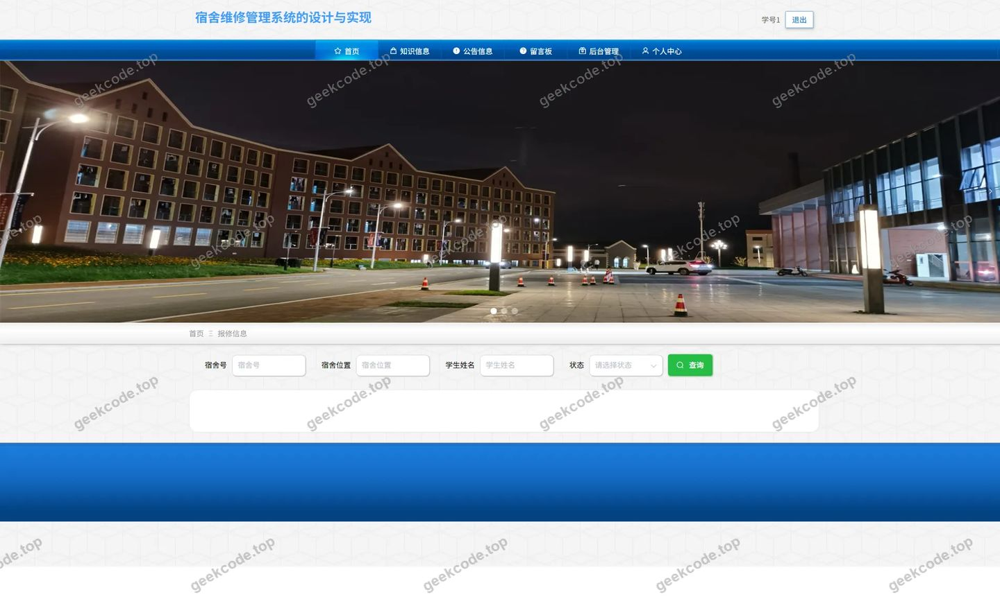</a>

<h4>前台-楼栋信息列表</h4>

<a href="https://geekcode.top/archives/%E5%AE%BF%E8%88%8D%E7%BB%B4%E4%BF%AE%E7%AE%A1%E7%90%86%E7%B3%BB%E7%BB%9F%E7%9A%84%E8%AE%BE%E8%AE%A1%E4%B8%8E%E5%AE%9E%E7%8E%B0?utm_source=github" title="查看完整源码">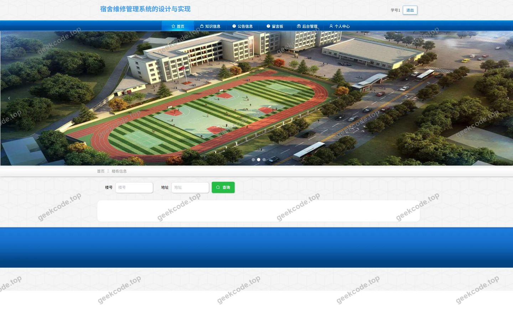</a>

<h4>前台-留言板列表</h4>

<a href="https://geekcode.top/archives/%E5%AE%BF%E8%88%8D%E7%BB%B4%E4%BF%AE%E7%AE%A1%E7%90%86%E7%B3%BB%E7%BB%9F%E7%9A%84%E8%AE%BE%E8%AE%A1%E4%B8%8E%E5%AE%9E%E7%8E%B0?utm_source=github" title="查看完整源码">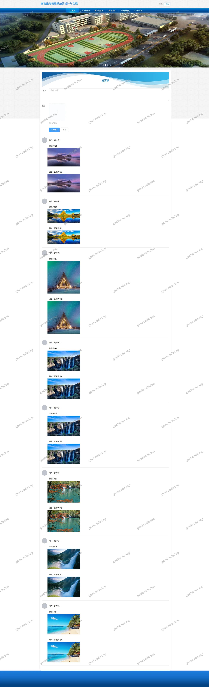</a>

<h4>前台-评价信息列表</h4>

<a href="https://geekcode.top/archives/%E5%AE%BF%E8%88%8D%E7%BB%B4%E4%BF%AE%E7%AE%A1%E7%90%86%E7%B3%BB%E7%BB%9F%E7%9A%84%E8%AE%BE%E8%AE%A1%E4%B8%8E%E5%AE%9E%E7%8E%B0?utm_source=github" title="查看完整源码">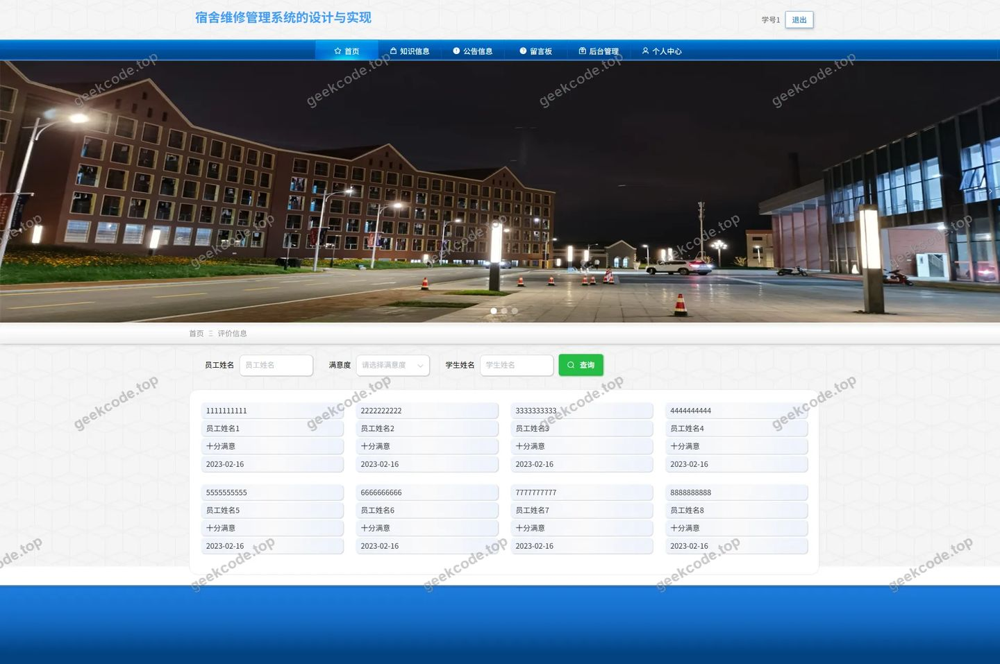</a>

<h4>前台-收藏列表</h4>

<a href="https://geekcode.top/archives/%E5%AE%BF%E8%88%8D%E7%BB%B4%E4%BF%AE%E7%AE%A1%E7%90%86%E7%B3%BB%E7%BB%9F%E7%9A%84%E8%AE%BE%E8%AE%A1%E4%B8%8E%E5%AE%9E%E7%8E%B0?utm_source=github" title="查看完整源码">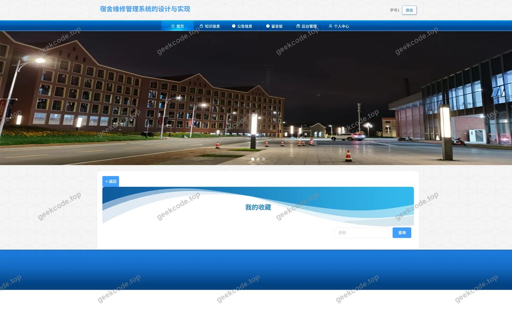</a>

<h4>前台-宿舍分配列表</h4>

<h4>前台-宿舍信息列表</h4>

<a href="https://geekcode.top/archives/%E5%AE%BF%E8%88%8D%E7%BB%B4%E4%BF%AE%E7%AE%A1%E7%90%86%E7%B3%BB%E7%BB%9F%E7%9A%84%E8%AE%BE%E8%AE%A1%E4%B8%8E%E5%AE%9E%E7%8E%B0?utm_source=github" title="查看完整源码">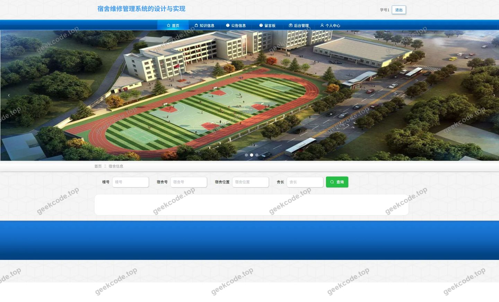</a>

<h4>前台-维修订单列表</h4>

<a href="https://geekcode.top/archives/%E5%AE%BF%E8%88%8D%E7%BB%B4%E4%BF%AE%E7%AE%A1%E7%90%86%E7%B3%BB%E7%BB%9F%E7%9A%84%E8%AE%BE%E8%AE%A1%E4%B8%8E%E5%AE%9E%E7%8E%B0?utm_source=github" title="查看完整源码">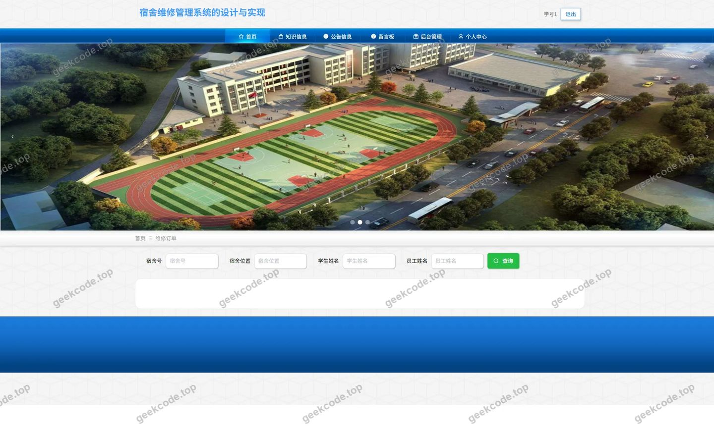</a>

<h4>前台-维修进度列表</h4>

<a href="https://geekcode.top/archives/%E5%AE%BF%E8%88%8D%E7%BB%B4%E4%BF%AE%E7%AE%A1%E7%90%86%E7%B3%BB%E7%BB%9F%E7%9A%84%E8%AE%BE%E8%AE%A1%E4%B8%8E%E5%AE%9E%E7%8E%B0?utm_source=github" title="查看完整源码">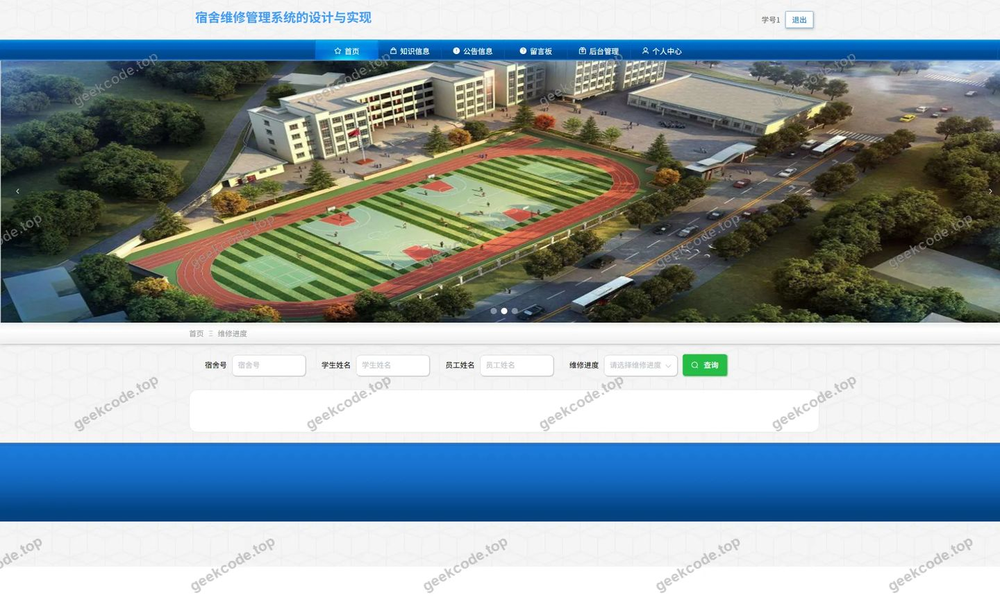</a>

<h4>前台-维修员列表</h4>

<h4>前台-知识分类列表</h4>

<a href="https://geekcode.top/archives/%E5%AE%BF%E8%88%8D%E7%BB%B4%E4%BF%AE%E7%AE%A1%E7%90%86%E7%B3%BB%E7%BB%9F%E7%9A%84%E8%AE%BE%E8%AE%A1%E4%B8%8E%E5%AE%9E%E7%8E%B0?utm_source=github" title="查看完整源码">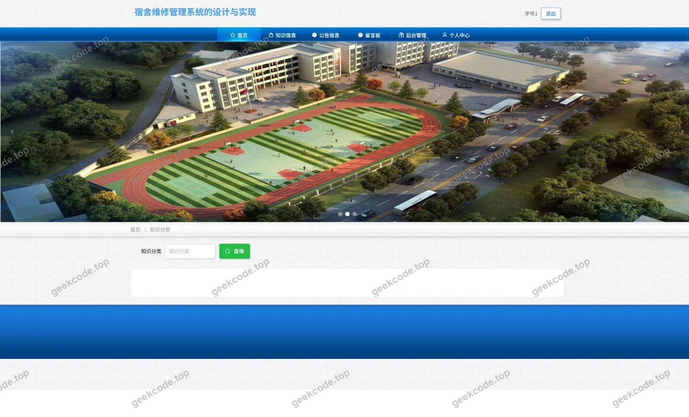</a>

<h4>前台-知识信息列表</h4>

<a href="https://geekcode.top/archives/%E5%AE%BF%E8%88%8D%E7%BB%B4%E4%BF%AE%E7%AE%A1%E7%90%86%E7%B3%BB%E7%BB%9F%E7%9A%84%E8%AE%BE%E8%AE%A1%E4%B8%8E%E5%AE%9E%E7%8E%B0?utm_source=github" title="查看完整源码">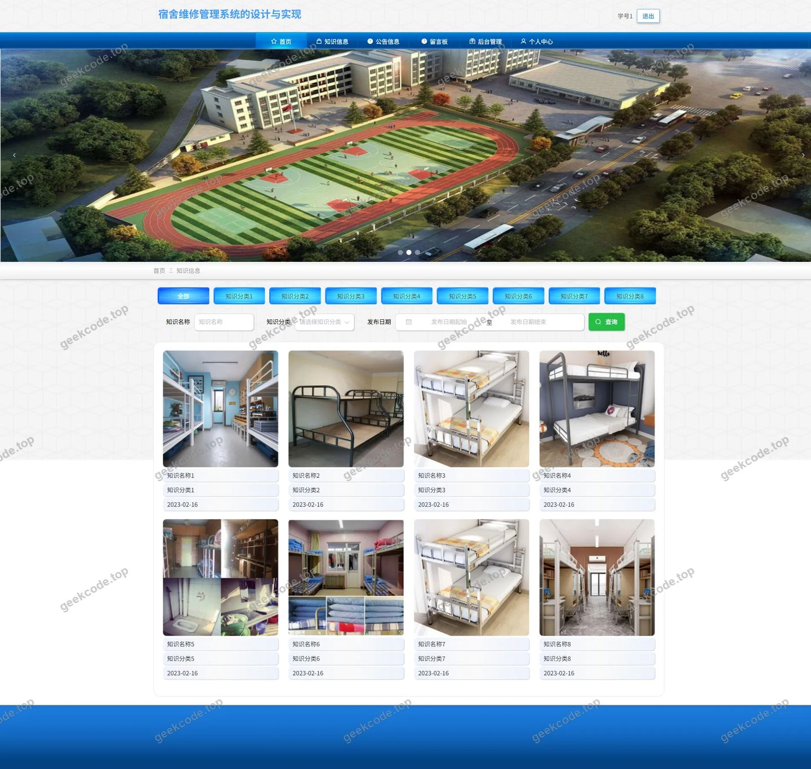</a>

<h4>前台-个人中心</h4>

<a href="https://geekcode.top/archives/%E5%AE%BF%E8%88%8D%E7%BB%B4%E4%BF%AE%E7%AE%A1%E7%90%86%E7%B3%BB%E7%BB%9F%E7%9A%84%E8%AE%BE%E8%AE%A1%E4%B8%8E%E5%AE%9E%E7%8E%B0?utm_source=github" title="查看完整源码">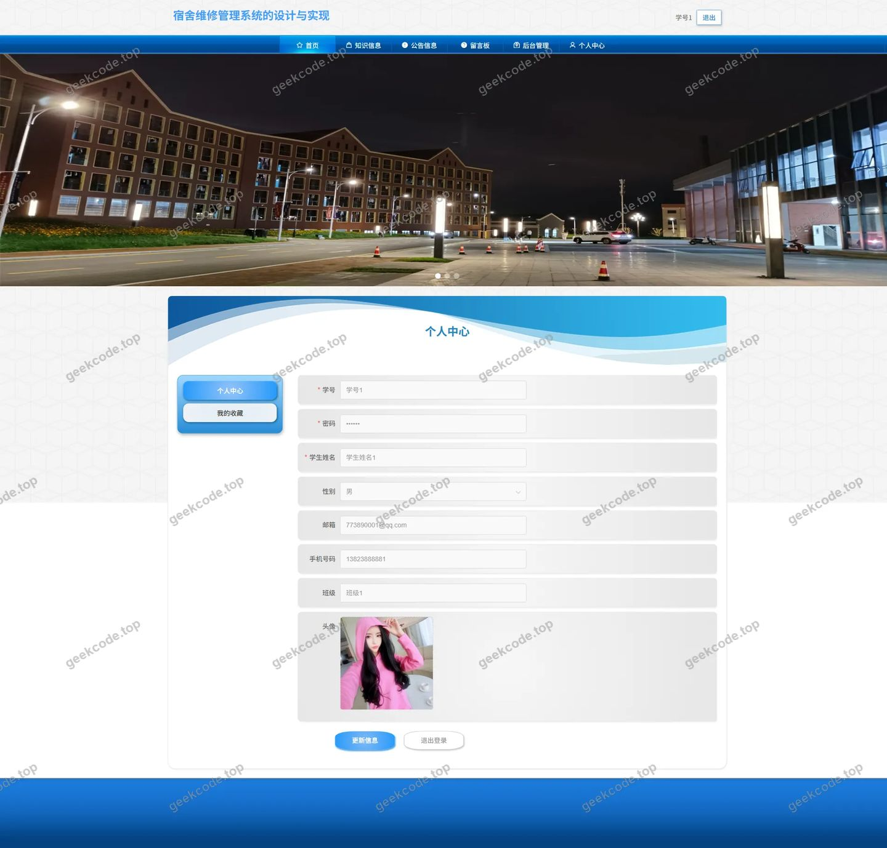</a>

<h4>前台-公告列表</h4>

<a href="https://geekcode.top/archives/%E5%AE%BF%E8%88%8D%E7%BB%B4%E4%BF%AE%E7%AE%A1%E7%90%86%E7%B3%BB%E7%BB%9F%E7%9A%84%E8%AE%BE%E8%AE%A1%E4%B8%8E%E5%AE%9E%E7%8E%B0?utm_source=github" title="查看完整源码">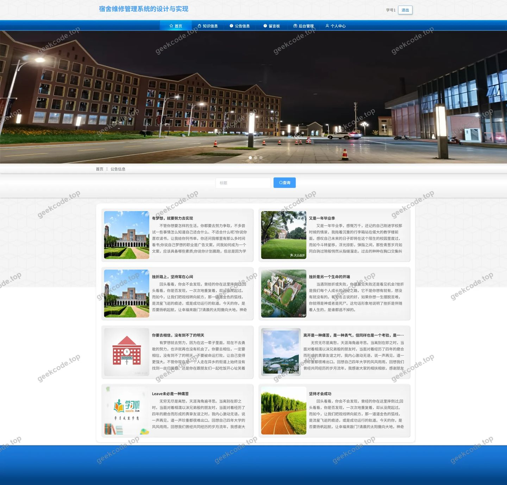</a>

<h3>后台管理端</h3>
<h4>后台-关于我们</h4>

<a href="https://geekcode.top/archives/%E5%AE%BF%E8%88%8D%E7%BB%B4%E4%BF%AE%E7%AE%A1%E7%90%86%E7%B3%BB%E7%BB%9F%E7%9A%84%E8%AE%BE%E8%AE%A1%E4%B8%8E%E5%AE%9E%E7%8E%B0?utm_source=github" title="查看完整源码">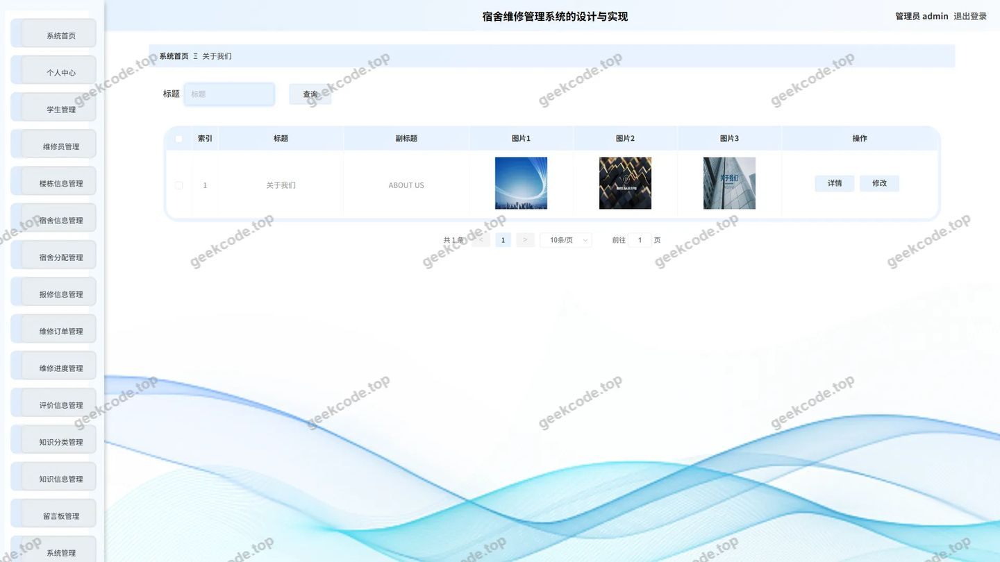</a>

<h4>后台-报修信息</h4>

<a href="https://geekcode.top/archives/%E5%AE%BF%E8%88%8D%E7%BB%B4%E4%BF%AE%E7%AE%A1%E7%90%86%E7%B3%BB%E7%BB%9F%E7%9A%84%E8%AE%BE%E8%AE%A1%E4%B8%8E%E5%AE%9E%E7%8E%B0?utm_source=github" title="查看完整源码">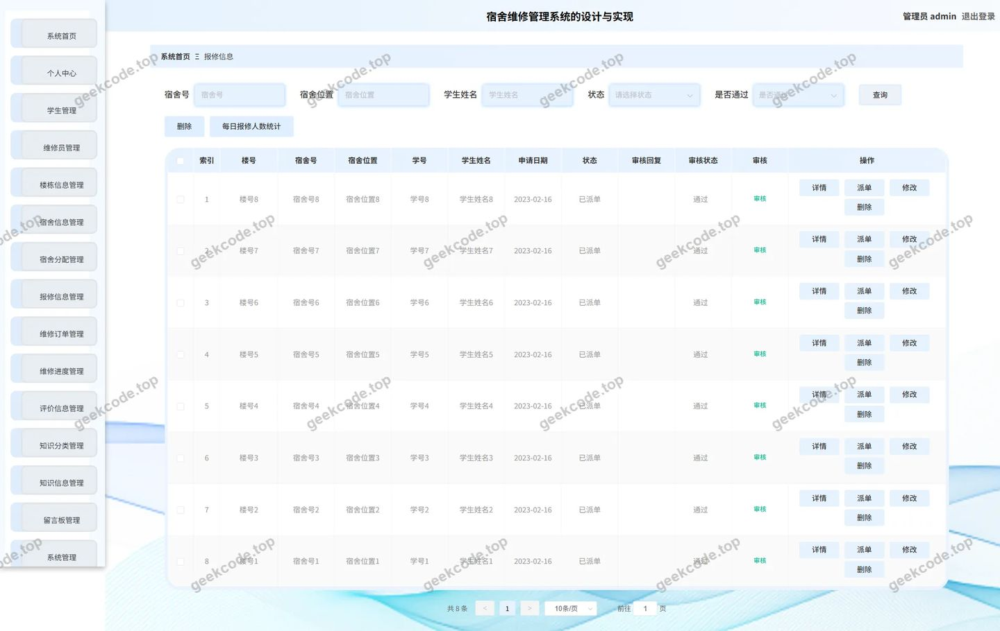</a>

<h4>后台-系统配置</h4>

<a href="https://geekcode.top/archives/%E5%AE%BF%E8%88%8D%E7%BB%B4%E4%BF%AE%E7%AE%A1%E7%90%86%E7%B3%BB%E7%BB%9F%E7%9A%84%E8%AE%BE%E8%AE%A1%E4%B8%8E%E5%AE%9E%E7%8E%B0?utm_source=github" title="查看完整源码">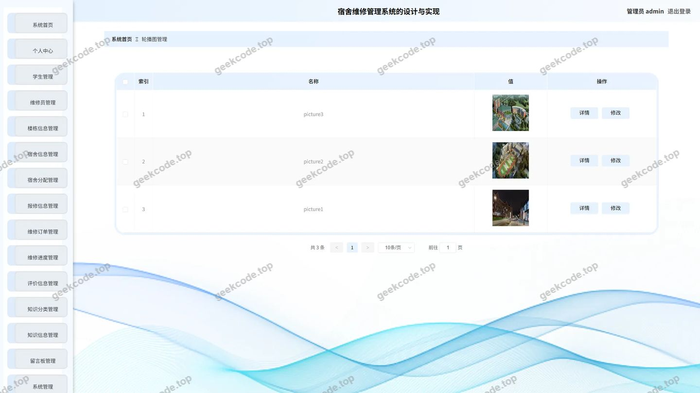</a>

<h4>后台-知识信息评论</h4>

<a href="https://geekcode.top/archives/%E5%AE%BF%E8%88%8D%E7%BB%B4%E4%BF%AE%E7%AE%A1%E7%90%86%E7%B3%BB%E7%BB%9F%E7%9A%84%E8%AE%BE%E8%AE%A1%E4%B8%8E%E5%AE%9E%E7%8E%B0?utm_source=github" title="查看完整源码">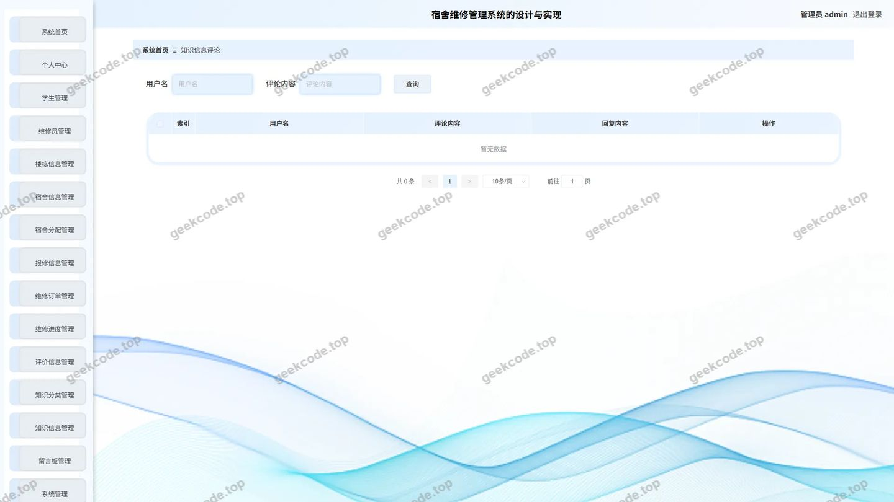</a>

<h4>后台首页</h4>

<a href="https://geekcode.top/archives/%E5%AE%BF%E8%88%8D%E7%BB%B4%E4%BF%AE%E7%AE%A1%E7%90%86%E7%B3%BB%E7%BB%9F%E7%9A%84%E8%AE%BE%E8%AE%A1%E4%B8%8E%E5%AE%9E%E7%8E%B0?utm_source=github" title="查看完整源码">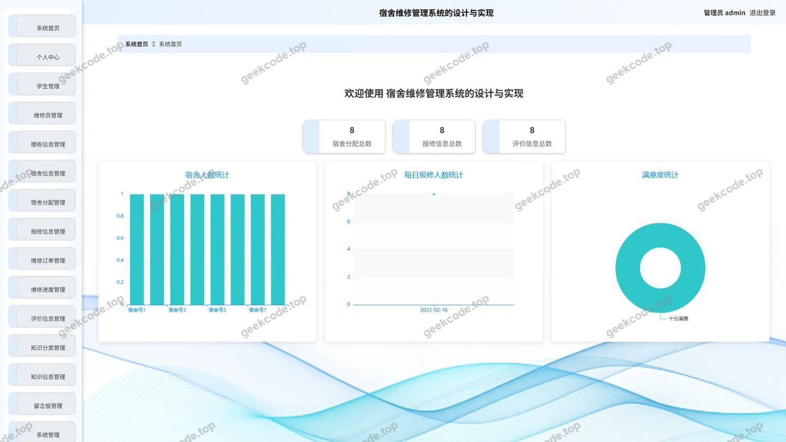</a>

<h4>后台-登录</h4>

<h4>后台-楼栋信息</h4>

<a href="https://geekcode.top/archives/%E5%AE%BF%E8%88%8D%E7%BB%B4%E4%BF%AE%E7%AE%A1%E7%90%86%E7%B3%BB%E7%BB%9F%E7%9A%84%E8%AE%BE%E8%AE%A1%E4%B8%8E%E5%AE%9E%E7%8E%B0?utm_source=github" title="查看完整源码">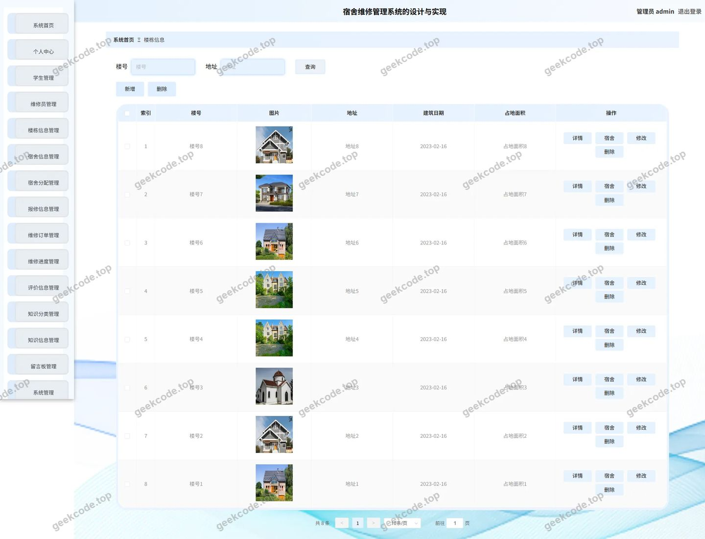</a>

<h4>后台-留言板</h4>

<a href="https://geekcode.top/archives/%E5%AE%BF%E8%88%8D%E7%BB%B4%E4%BF%AE%E7%AE%A1%E7%90%86%E7%B3%BB%E7%BB%9F%E7%9A%84%E8%AE%BE%E8%AE%A1%E4%B8%8E%E5%AE%9E%E7%8E%B0?utm_source=github" title="查看完整源码">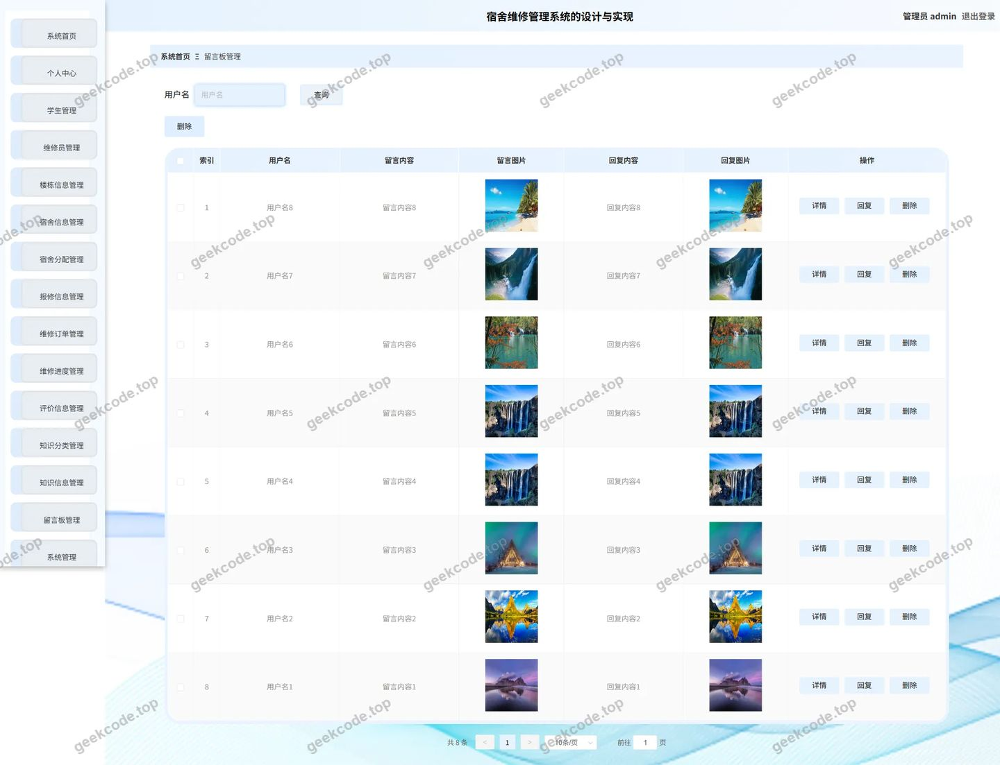</a>

<h4>后台-公告信息</h4>

<a href="https://geekcode.top/archives/%E5%AE%BF%E8%88%8D%E7%BB%B4%E4%BF%AE%E7%AE%A1%E7%90%86%E7%B3%BB%E7%BB%9F%E7%9A%84%E8%AE%BE%E8%AE%A1%E4%B8%8E%E5%AE%9E%E7%8E%B0?utm_source=github" title="查看完整源码">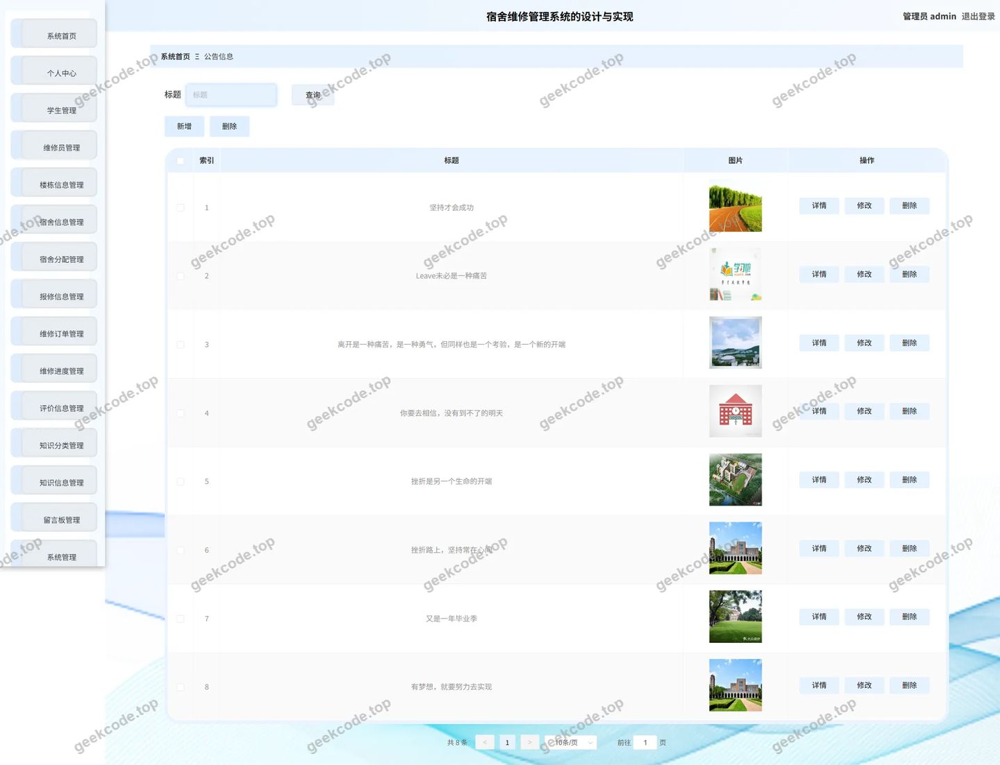</a>

<h4>后台-评价信息</h4>

<a href="https://geekcode.top/archives/%E5%AE%BF%E8%88%8D%E7%BB%B4%E4%BF%AE%E7%AE%A1%E7%90%86%E7%B3%BB%E7%BB%9F%E7%9A%84%E8%AE%BE%E8%AE%A1%E4%B8%8E%E5%AE%9E%E7%8E%B0?utm_source=github" title="查看完整源码">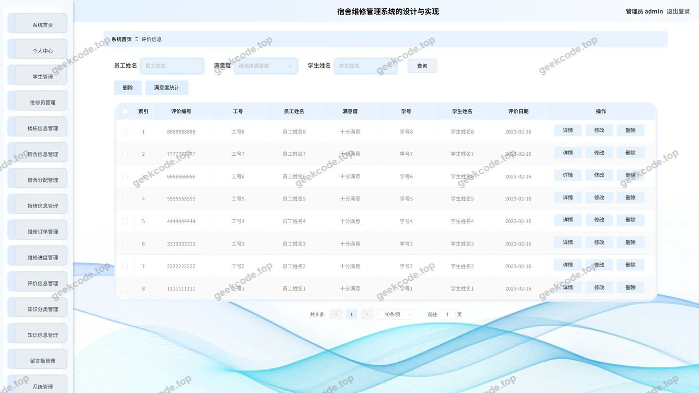</a>

<h4>后台-宿舍分配</h4>

<a href="https://geekcode.top/archives/%E5%AE%BF%E8%88%8D%E7%BB%B4%E4%BF%AE%E7%AE%A1%E7%90%86%E7%B3%BB%E7%BB%9F%E7%9A%84%E8%AE%BE%E8%AE%A1%E4%B8%8E%E5%AE%9E%E7%8E%B0?utm_source=github" title="查看完整源码">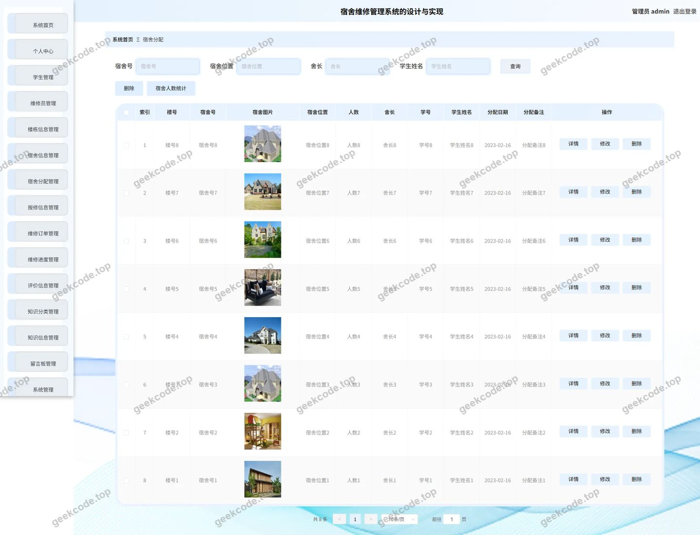</a>

<h4>后台-宿舍信息</h4>

<a href="https://geekcode.top/archives/%E5%AE%BF%E8%88%8D%E7%BB%B4%E4%BF%AE%E7%AE%A1%E7%90%86%E7%B3%BB%E7%BB%9F%E7%9A%84%E8%AE%BE%E8%AE%A1%E4%B8%8E%E5%AE%9E%E7%8E%B0?utm_source=github" title="查看完整源码">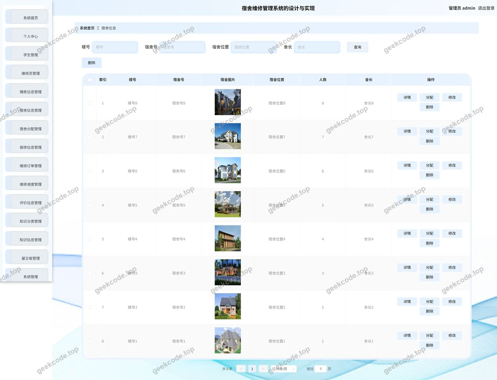</a>

<h4>后台-维修订单</h4>

<a href="https://geekcode.top/archives/%E5%AE%BF%E8%88%8D%E7%BB%B4%E4%BF%AE%E7%AE%A1%E7%90%86%E7%B3%BB%E7%BB%9F%E7%9A%84%E8%AE%BE%E8%AE%A1%E4%B8%8E%E5%AE%9E%E7%8E%B0?utm_source=github" title="查看完整源码">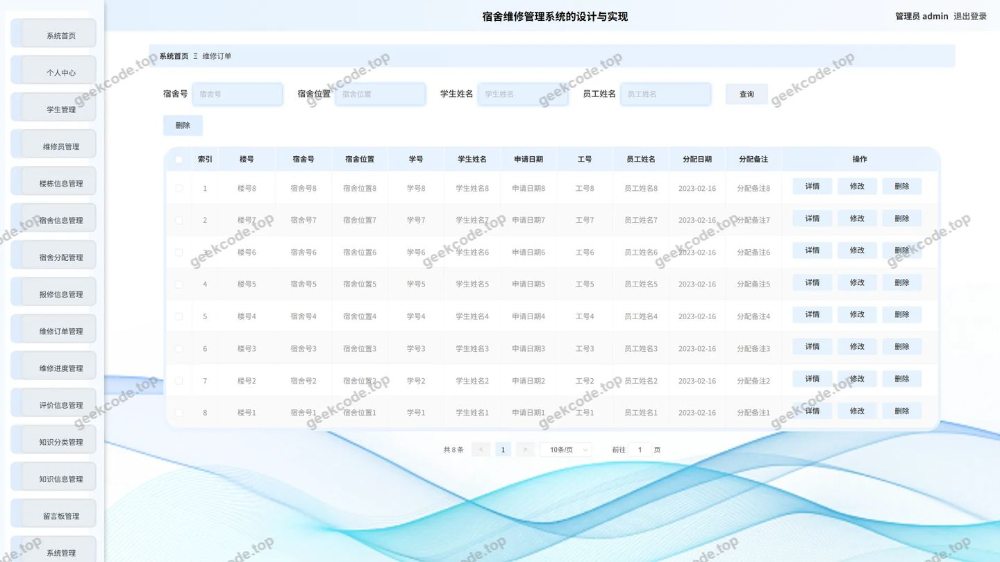</a>

<h4>后台-维修进度</h4>

<a href="https://geekcode.top/archives/%E5%AE%BF%E8%88%8D%E7%BB%B4%E4%BF%AE%E7%AE%A1%E7%90%86%E7%B3%BB%E7%BB%9F%E7%9A%84%E8%AE%BE%E8%AE%A1%E4%B8%8E%E5%AE%9E%E7%8E%B0?utm_source=github" title="查看完整源码">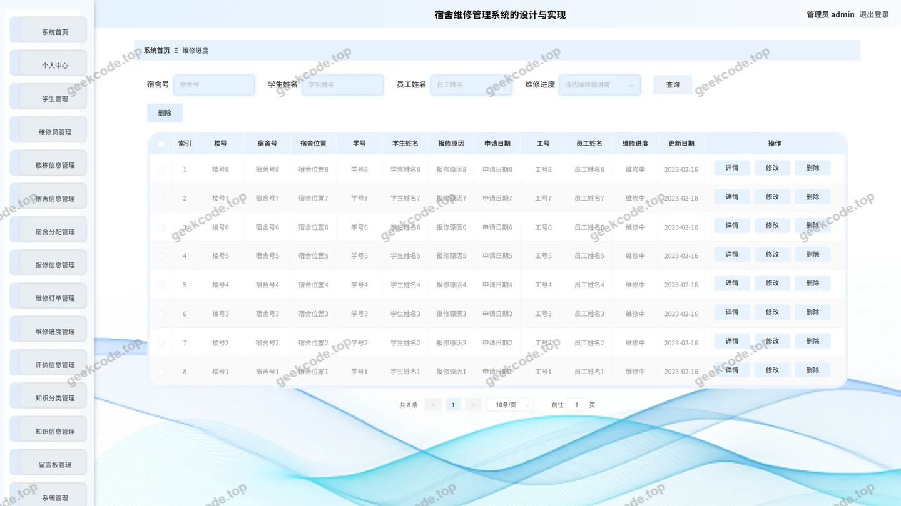</a>

<h4>后台-维修员</h4>

<a href="https://geekcode.top/archives/%E5%AE%BF%E8%88%8D%E7%BB%B4%E4%BF%AE%E7%AE%A1%E7%90%86%E7%B3%BB%E7%BB%9F%E7%9A%84%E8%AE%BE%E8%AE%A1%E4%B8%8E%E5%AE%9E%E7%8E%B0?utm_source=github" title="查看完整源码">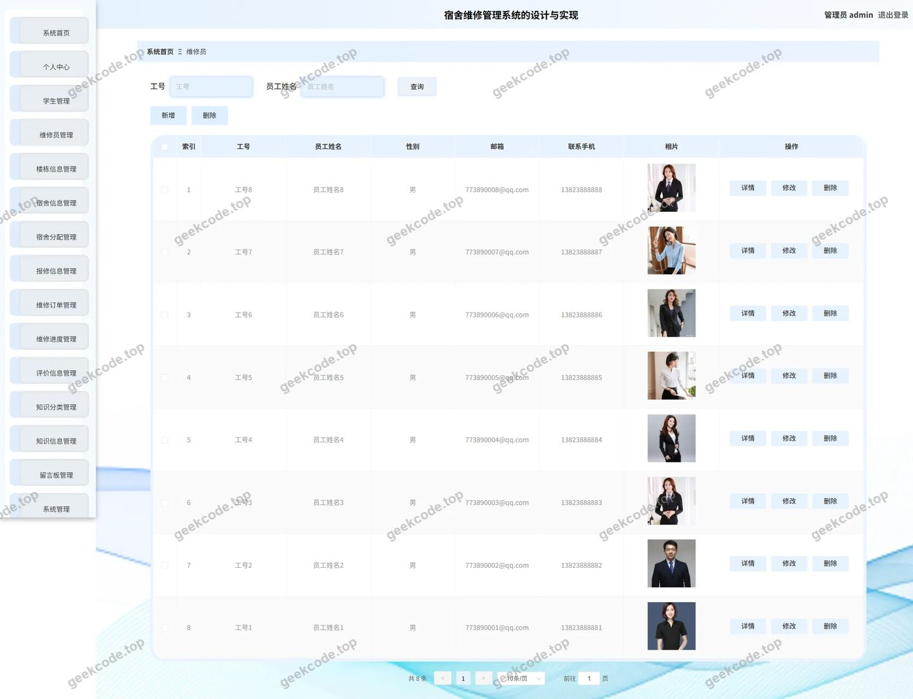</a>

<h4>后台-学生</h4>

<a href="https://geekcode.top/archives/%E5%AE%BF%E8%88%8D%E7%BB%B4%E4%BF%AE%E7%AE%A1%E7%90%86%E7%B3%BB%E7%BB%9F%E7%9A%84%E8%AE%BE%E8%AE%A1%E4%B8%8E%E5%AE%9E%E7%8E%B0?utm_source=github" title="查看完整源码">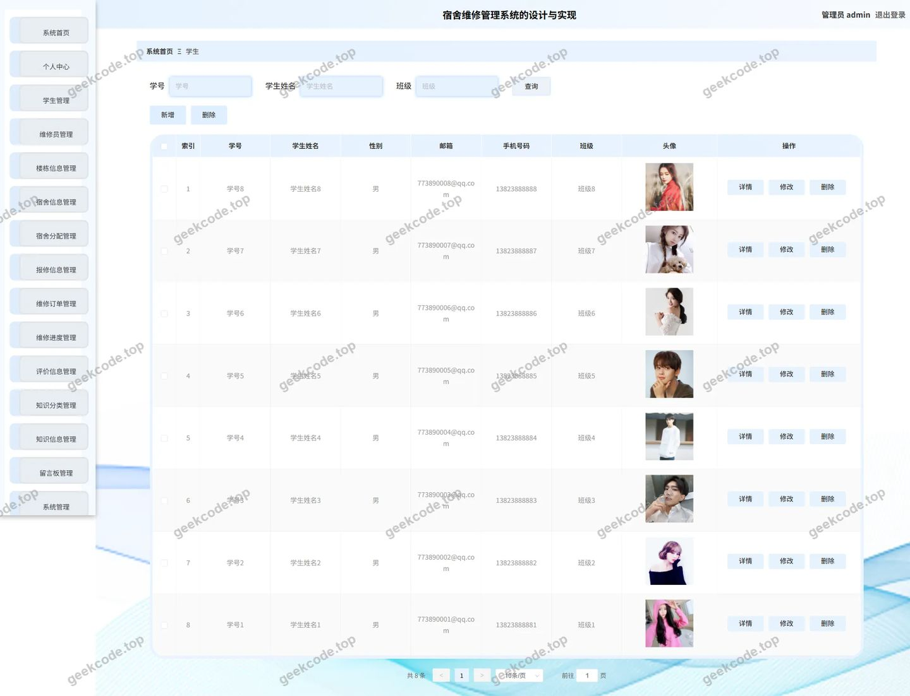</a>

<h4>后台-知识分类</h4>

<a href="https://geekcode.top/archives/%E5%AE%BF%E8%88%8D%E7%BB%B4%E4%BF%AE%E7%AE%A1%E7%90%86%E7%B3%BB%E7%BB%9F%E7%9A%84%E8%AE%BE%E8%AE%A1%E4%B8%8E%E5%AE%9E%E7%8E%B0?utm_source=github" title="查看完整源码">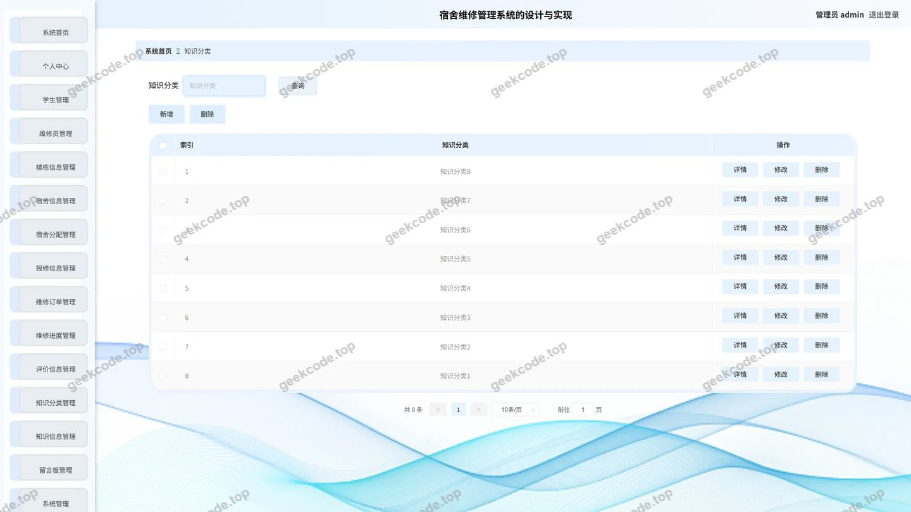</a>

<h4>后台-知识信息</h4>

<a href="https://geekcode.top/archives/%E5%AE%BF%E8%88%8D%E7%BB%B4%E4%BF%AE%E7%AE%A1%E7%90%86%E7%B3%BB%E7%BB%9F%E7%9A%84%E8%AE%BE%E8%AE%A1%E4%B8%8E%E5%AE%9E%E7%8E%B0?utm_source=github" title="查看完整源码">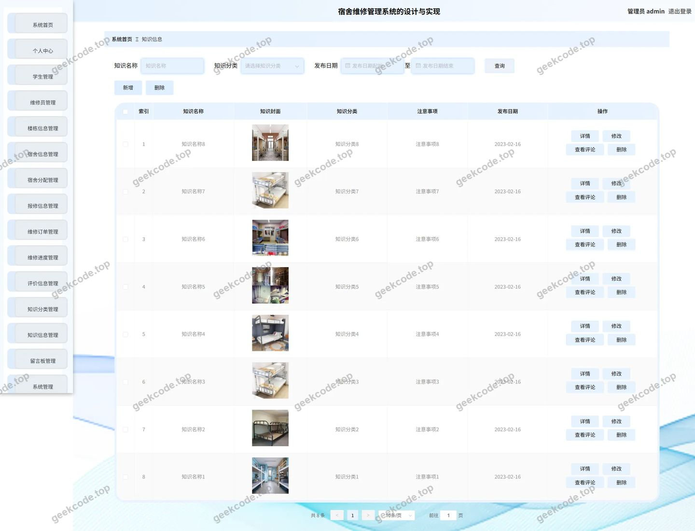</a>

---

## 获取完整源码

| 项目 | 说明 |
| --- | --- |
| 项目名 | 宿舍维修管理系统的设计与实现 |
| 运行截图 | 本文 32 张（站点带水印原图，仓库 `images/` 目录） |
| 完整源码 | [https://geekcode.top/archives/%E5%AE%BF%E8%88%8D%E7%BB%B4%E4%BF%AE%E7%AE%A1%E7%90%86%E7%B3%BB%E7%BB%9F%E7%9A%84%E8%AE%BE%E8%AE%A1%E4%B8%8E%E5%AE%9E%E7%8E%B0?utm_source=github](https://geekcode.top/archives/%E5%AE%BF%E8%88%8D%E7%BB%B4%E4%BF%AE%E7%AE%A1%E7%90%86%E7%B3%BB%E7%BB%9F%E7%9A%84%E8%AE%BE%E8%AE%A1%E4%B8%8E%E5%AE%9E%E7%8E%B0?utm_source=github) |
| 咨询微信 | **ir9372**（备注：jingpin-yuanma） |
| 更多项目 | [极客代码 geekcode.top](https://geekcode.top/?utm_source=github) |

> 需要源码、部署、改配置、跑不起来等问题，加微信 ir9372 沟通，说明项目名即可。
